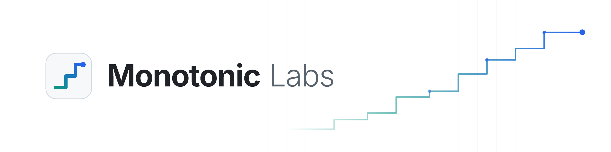

<picture>
  <source media="(prefers-color-scheme: dark)" srcset="assets/banner-dark.png">
  <source media="(prefers-color-scheme: light)" srcset="assets/banner-light.png">
  
</picture>

## Ahoy, and welcome

Monotonic Labs is a privacy-focused machine learning lab building small, capable AI systems for individuals and small businesses. Today we host each customer's private model in Monotonic's own isolated infrastructure, never a third party's. Next, an edge client brings that work onto the hardware they already own. We believe useful intelligence should not cost you control of your data, and we design every system around that conviction from the very first line.

## What we build

- **Small models, well tuned** - compact systems shaped for laptops, phones, and modest on-premise hardware rather than sprawling data centers.
- **Private hosting now, the edge next** - each customer's model runs isolated inside Monotonic today. The edge client will do that work on the customer's own machine, fast, dependable, and available even when the network is not.
- **Practical AI for SMBs** - focused solutions for small and medium businesses that want the benefits of machine learning without the overhead of a cloud contract.

## What we believe

- **Privacy is the default, not a feature** - your data stays yours: encrypted in transit and at rest, used only for your own model, and never shared.
- **Smaller is often better** - an elegant, efficient model you can run and understand beats a grandiose one you can only rent.
- **Progress only moves one way** - like our namesake, we aim to improve steadily and never regress, release after release.

## Projects

Our work is currently private while we polish it for release. Robust things are on the way, so keep an eye on this page.
